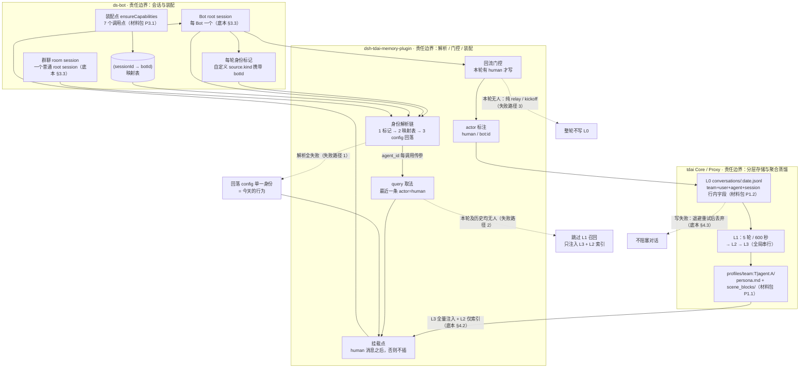

# 方案：会话级身份解析 + 人机标注，让每个 Bot 稳定对应一个 tdai agent，L2/L3 随 Bot 隔离、user 共用

> ⚠️ **废案（2026-10-22 标记）**：本文件**不作为实施依据**，仅供查阅历史推导与被推翻的旧表述。
> 实施规格以 [minimal.md](./minimal.md)（人读）与 [minimal.agents.md](./minimal.agents.md)（执行层）为准；
> 时序证据见 [timing-probe.md](./timing-probe.md)。
## 1. 判断

矛盾不在 tdai 侧：L2/L3 本就按 `team + agent` 隔离，新建 agent 即拿到独立场景块与画像（材料包 P1.1、P1.3）。矛盾在接入侧两处哑点叠加：插件把 TDAI 身份当**进程常量**（底本 §5.1），而 Bot 是 root session、会话头与用户会话不可区分（材料包 P4.2）；插件用 `source.kind === 'user'` 认人（底本 §5.4），而 Bot 会话里一条 `kind='user'` 都没有（底本 §2.5）。两个哑点落在同一条消息流上：认不出「谁的会话」，也认不出「谁在说话」，于是身份唯一、画像唯一、L0 里堆的是机器产出。

## 2. 选档与理由

| 档 | 内容 | 判断 |
| --- | --- | --- |
| 0 | 两者不同时使用 | 拒绝：三处冲突继续污染 L0（底本 §6），Bot 读到的是人的画像 |
| 1 | 只回流会话结果、历史不回流 | 拒绝：L1/L2/L3 是聚合多条 L0 后异步蒸馏（材料包 P1.5），只喂结论不喂证据；且它完全不改身份，Bot 仍共享同一份 L3 |
| 2 | **本方案**：会话级身份解析 + 人机标注 + 门控回流 + 按 agent 装配 | 采用 |
| 3 | 每 Bot 一个 dsh 进程（天然一进程一身份） | 拒绝：与「Every Bot is one root Session」（底本 §3.3）冲突，会把进程内协作、群聊、团队工具切碎，代价最高 |

选档 2 的理由：它不动协议。`agent_id` 本来就是每次调用的请求参数（底本 §5.1，`recall.mjs:219-220`、`assets.mjs:206`），改的只是**从哪取值**；config 里的单一身份不删，降级为解析失败时的回落值，因此普通用户路径不动。

## 3. 架构图

## 4. 机制设计

十点对应：①4.1 ②§3 ③4.2 ④4.3 ⑤4.4 ⑥4.5 ⑦4.7 ⑧§5 ⑨§6 ⑩§7。

### 4.1 三处冲突逐条回应（点 1）

| # | 冲突 | 处置 |
| --- | --- | --- |
| 1 | 真人判定不一致（底本 §6.1） | 插件内两套标准（`lastUserText` 不判 kind vs `humanUserTexts` 判 kind，底本 §5.3）合并为一个谓词 `isHuman(msg)`。基线 = `role==='user' && (kind 缺省 \|\| kind==='user')`；**仅当会话已解析出 Bot 身份**时，再收 `user-question-reply`（底本 §3.5：卡片回答是人选的）。挂载点改为：本轮无 human 消息则**不插**，而不是插到末尾（底本 §5.3，`recall.mjs:369-370`）。【推断】插末尾会让下一轮 `lastUserText` 取到插件自己的召回块（它既不判 role 也不判 kind），形成自我召回——必须堵，但未实测（§8.5） |
| 2 | 回流白名单不匹配（底本 §6.2） | 白名单从「role + 单一 kind」重写为「role + actor + 轮级门控」，见 4.3。人的卡片选择、Bot 间消息、群聊发言不再无条件丢弃；纯机器轮整轮不写 |
| 3 | 身份粒度（底本 §6.3） | 不改「多身份不做」这个已否决决策本身（底本 §5.1），改的是取值来源：从「加载时读一次 config」改为「每次调用按当前会话解析」。config 保留为第 3 层回落 |

### 4.2 身份模型（点 3）

三层解析链，命中即止：

1. **会话标记**：ds-bot 在 Bot 会话每轮注入一条带 `botId` 的标记消息，复用现成的 `source.kind` 自定义契约与 `agent/pre-step` 钩子（底本 §2.5、§3.5）。插件扫**最近一条该 kind 的消息**，不是「最后一条消息」。
2. **映射表**：`(sessionId → botId)` 由 ds-bot 在已有的 7 个 `ensureCapabilities` 装配点写入（材料包 P3.1）。理由：插件每次调用天然持有 session_id（底本 §5.1），而会话头不透露 Bot 信息（材料包 P4.2），映射只能由 ds-bot 主动产出。
3. **config 回落**：都拿不到 → 用今天的单一身份，行为不变。

映射规则：`agent_id = "dsbot-" + bot.id`（字符集限 `[a-z0-9-]`，见 §6 缺口 3），team 沿用 config；单向派生，不建手工登记表，避免漂移。user 维度共用同一个 user_id（要求 3）。

### 4.3 回流策略（点 4）

actor 三分：`human`（`user` / `user-question-reply`）、`bot:<id>`（assistant 文本与同 step 工具产出）、`host`（各注入块）。

**门控**：一轮写入 L0 的充要条件 = 该轮至少有一条 `actor=human` 的消息。纯 relay / kickoff / 定时触发的轮整轮不写（材料包 P0.5 末段：只沉淀人为介入的部分）。

| | 内容 |
| --- | --- |
| 进 L0 | 人的原话；人的卡片选择（标 `human\|card`，questions/answers 已在 source 里，底本 §3.5）；被门控轮里的 bot 产出，标 `bot:<id>`，**只作上下文** |
| 不进 L0 | `ds-bot-time-context` / runtime-context / skill-catalog / `[Bot team setup]` 等注入块；插件自身注入块；无人的整轮；reasoning（现有实现已丢弃，底本 §5.4） |

标注方式三级：①首选结构化 actor 字段写进 L0 —— `/v3/conversation/add` 的字段集材料未给（§8.3），**待确认**；②保底 role 位（human→`user`，bot→`assistant`）+ 正文结构化前缀 `[actor=bot:<id>]`；③插件本地留一份写入台账，供 §7 A3 对账。不承诺 Core 抽取侧会尊重该标注（§6）。

### 4.4 注入契约（点 5）

- **query**：L1 query = 本会话最近一条 `actor=human` 的文本；本轮无则回溯历史最近一条；历史也没有 → **不发 L1 请求**，只注入 L3 与 L2 索引。改写点 `recall.mjs:281`。今天取的是「第一条有文本的消息」且不判 role/kind（底本 §5.3），Bot 会话里必然取到注入块。skill query 逻辑不变，但复用同一谓词，消除同文件两套标准；skill 块在 Bot 会话缺失的归因未闭合（底本 §7 第 2 条），本方案不预设原因，改完 query 重测。
- **挂载点**：插在本轮最后一条 human 消息之后；找不到则不插（理由见 4.1 冲突 1）。
- **预算**：段序与 order 不变（520/521/522，底本 §5.2）。身份标记**不进 system**——system 是前缀，会话内易变字节进去就打穿缓存（底本 §5.2），这是硬约束。预算口径用实测基线：Bot 会话 system 34,027 字符 vs 普通 23,275（+46.2%）、tools schema 83,420（底本 §2.2）。L3 全量注入是新增固定成本，L2 只进索引（底本 §4.2）。阈值走配置，不在本方案写死。

### 4.5 多 agent 的记忆归属（点 6）

先说我理解的三个概念：

- **tdai Agent**：纯元数据实体，Core 不托管不调度（底本 §4.1、材料包 P2.1）；唯一性 `team_id + agent_id`。它是**记忆归属的键**。
- **L2/L3**：`team + agent` 级 profile，不消费 sessionId（材料包 P1.3）；**L0/L1** 则是 `(team, user, agent, session)` 的行内字段（材料包 P1.2）。即「按 Bot 独立」在存储层已成立，缺的只是调用侧传对 agent_id。
- **ds-bot Bot**：root session + roster 记录（instructions/model/capabilities，材料包 P3.3），是**运行与装配单元**。

据此的对应规则：

1. **一对一**：`Bot.id ↔ agent_id = dsbot-<bot.id>`，按 `team+agent` 唯一性幂等创建（Bot 创建或首次活跃时）。
2. **L2/L3 写入走默认归属**（运行时按当前 agent 读自身 L2/L3，材料包 P1.4）。第一版不启用 Loadout。将来若要跨 Bot 读场景，用 Fixed Binding 借入、读取时标记来源 agent（材料包 P1.4）；但 `agent-fixed-asset/set` 是全量覆盖（材料包 P2.3），必须先 `list-with-detail` 读全量再合并，否则清掉用户已有绑定。
3. **user 维度共用**：user_id 沿用 config 中那一个；同一人的 L0/L1 分散在各 agent 名下，跨 agent 聚合不在本方案范围。
4. **冷启动**：新 agent 的 L2/L3 从零长，不继承（材料包 P1.5；「不继承」本身是推断 → 依赖缺口 5）。接受，不承诺继承。退路：可选的一次性引导回流——把该 Bot 历史轮按 4.3 门控重放写入 L0，交给管道蒸馏；失败即放弃，不影响主路径（可行性见 §8.8）。
5. **不做**：不把 Bot 的 `instructions` 同步进 AgentEntity.prompt（同性质但属另一子系统，底本 §4.1 明确 Core 不运行 agent），第一版不引入。

群聊（张力 5）：room 是普通 root session（底本 §3.3）。方案是每个 room 建独立 agent（`dsbot-room-<roomId>`），人的发言与房间上下文落在它名下。拒绝「落进各参与 Bot 的 agent」：同一段对话被 n 个 agent 各蒸馏一遍，成本 ×n，而 L3 全局串行（材料包 P1.6）会互相排队，房间发言也会污染各 Bot 画像。代价：Bot 在群里说的话不进它自己的 L2/L3，需要时借入 room agent 的资产。

### 4.6 兼容与回滚（点 7）

唯一行为分叉点是**「本会话是否解析出 Bot 身份」**。解析不出 → 旧谓词、旧挂载、旧白名单、config 身份，即今天的行为；普通用户（一个会话、无 Bot）永远落在这里。

普通会话里新 kind 是否出现未取证（§8.4），所以新增 kind **只在 Bot 分支启用**，不用「超集等价」去赌。另设总开关，关闭即回到今天的行为。数据侧不删任何东西：actor 标注与新建 agent 目录都是增量；不想要某 Bot 的记忆，删它的 profile 目录即可（路径含 URL 编码，材料包 P1.1）。system prompt 保持不变（底本 §2.4 实测 ds-bot 未改插件注入内容），以免打穿缓存。

## 5. 落地步骤（点 8）

**最小第一步（≤1 小时，只做身份可见性，不碰记忆）**：ds-bot 在 Bot 会话的身份标记里加 `botId`（复用 time-context 的钩子与 source 契约，底本 §2.5、§3.5）；插件在 pre-step 解析并打一行 stderr 日志 `resolved bot=… via=marker|map|config`。判定：开 Bot A、Bot B 各说一句，再开一个普通会话说一句 —— 三行日志必须是 `A / marker`、`B / marker`、`config`。全中即成功；任一错就停在身份层。改动约两个文件、三个会话、20 分钟跑完。若 §8.1 导致标记不稳，退路是直接做第 2 层映射表，日志变为 `via=map`。

- 第 2 步 谓词与挂载点统一（Bot 分支生效）：日志打印实际 L1 query 前 40 字符与是否插入。判定：query = 人的原话且 ≠ 任何注入块文本；纯 relay 轮无召回请求。顺带闭合底本 §7 第 1 条。
- 第 3 步 回流门控 + actor 标注：判定见 §7 A3。
- 第 4 步 身份路由生效（agent_id 按 Bot 派生 + 建 agent）：判定见 §7 A1。
- 第 5 步（可选）room agent、历史引导回流、Loadout 借入。

## 6. 风险与代价（点 9）

- **L1 阈值 5 轮 / 600 秒**（材料包 P1.6、底本 §4.2）：验收必须等阈值触发，「说完就查」一定查不到，脚本要按 600 秒设计等待；Bot 越多，验证周期越长。
- **L3 全局串行 concurrency=1**（材料包 P1.6）：n 个 Bot 同时冷启动会排队，后长出来的画像会延迟。
- **提示词预算**：Bot 会话已比普通会话多 10,769 字符 system（+46.2%）、tools schema 多 17,695（底本 §2.2）；再叠加每 agent 一份 L3 全量注入（底本 §4.2），固定成本上升，且不能用「身份写进 system」来换——会打穿前缀缓存（底本 §5.2）。
- **抽取语义不受控**：actor 标注是写入侧的，Core 抽取是否据此区分人机，材料给不出答案（§8.6）。若被忽略，机器产出仍有被抽成「关于用户的事实」的风险（底本 §6.2 已实测到该后果）。
- **已否决决策的复访成本**：多身份是记录在案的否决（底本 §5.1）。本方案只加解析层、不改 config 语义，但过会时仍需带这套理由。
- **数据放大**：门控只保证纯机器轮不写；有人介入的轮里 bot 产出仍进 L0，L0 行数与向量库体积上升（本机 `vectors.db` 已 61 MB，材料包 P1.1）。
- **依赖缺口**：缺口 1（L2/L3 目录谁建）→ 不依赖预建，懒建失败则重试；缺口 2（同 session 换 agent_id 后 L0 归属）→ 一次会话一个 Bot；缺口 3（目录名 URL 编码）→ agent_id 只用 `[a-z0-9-]`；缺口 5（不继承未实测）→ 不承诺，按实测写文档。缺口 4/6/7 不依赖。

## 7. 验收方法（点 10）

标记串穿透测试是主手段：Bot A 说 `紫色考拉`，Bot B 说 `橙色水獭`。

| # | 通过的样子 | 不通过的样子 |
| --- | --- | --- |
| A1 隔离 | 各跑 ≥6 轮或等 600 秒后，`profiles/` 出现两个目录（材料包 P6 复现命令）；A 的 `persona.md` 与场景块含「紫色考拉」不含「橙色水獭」，B 反之 | 只有一份 profile；或 A 的文件里出现 B 的标记串 |
| A2 召回隔离 | 在 A 会话问一句与两串都相关的话，L1 召回块只出 A 的标记串 | 出现 B 的 |
| A3 人机标注与门控 | 造一轮纯 relay：当日 L0 文件行数不变；再造一轮人提问 + Bot 长回答：人的消息在、bot 产出带 actor 标注且不冒充人 | relay 轮写进 L0；或人提问轮里人的消息缺失 |
| A4 普通用户无回归 | 改动前后同一普通会话跑同样两轮：system prompt 段逐行相同（底本 §8.1 diff 脚本可复用）、召回块与本轮注入的相对顺序不变、L0 角色分布一致 | 任一处 diff |
| A5 query 正确性 | 日志里 L1 query = 人的原话（前 40 字符）且 ≠ 任何注入块文本；无人的轮无请求 | query 是 `<session_context>` / `Current time` / 召回块自身（§8.5 的推断在此被证实或证伪） |
| A6 预算 | 改动后 Bot 会话的 system 字符数与底本 §2.2 基线 34,027 同级，不因身份注入增长 | 涨了，说明有东西进了 system |
| A7 冷启动时长（参考项） | 记录从 Bot 首次发言到 `persona.md` 出现的时间，核对 §6 的排队代价 | 不作为通过门槛 |

## 8. 我不确定的（诚实清单）

1. **身份标记能否每轮注入**：材料只写 `Current time` 每 10 分钟刷新（底本 §2.5 注 3），没写它是每轮都发还是只在刷新时发。若只在刷新时发，解析链第 1 层会漏（退路：第 2 层映射表）。
2. **映射表落点**：ds-bot 的 `state.json` 实测字段里没有 sessionId（材料包 P3.3），「(sessionId → botId)」写在哪、插件能否安全读到，未取证。
3. **写 L0 的请求体字段集**：材料只给了端点 `/v3/conversation/add`（底本 §4.3），无字段清单。因此 actor 标注的首选形式是否可行未知——这是本方案最可能在第一步就被否掉的点。
4. **普通会话里** `user-question-reply` 与 `ask_user_question` 回答的 `source.kind` 是什么，未取证；4.6 的「只在 Bot 分支启用」就是为它留的保险。
5. **召回块自身的 `source.kind`**（底本 §2.5 观察到 `plugin:dsh-tdai-memory-plugin`）以及它会不会被 `lastUserText` 取到——4.1 的自我召回是【推断】，未实测。
6. **Core 抽取提示词是否尊重写入侧 actor 标注**。这决定冲突 2 是否真的被解决。
7. **room session 的 id 在插件侧是否可取**（room agent 的前提）。
8. **历史引导回流**：Core 是否接受历史时间戳 / 乱序写入。
9. **新 agent 首次 L3 的实际体量**：21,237 B 是本机唯一 profile 的观测（材料包 P1.1），不能直接外推做预算。
10. **缺口 1/2/3/5 未实测**，§6 已给退路；缺口 4/6/7 本方案不依赖。
