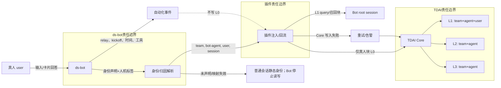

# 方案：以稳定映射和人机归因，把 Bot 会话装配为独立 TDAI agent

> ⚠️ **废案（2026-10-22 标记）**：本文件**不作为实施依据**，仅供查阅历史推导与被推翻的旧表述。
> 实施规格以 [minimal.md](./minimal.md)（人读）与 [minimal.agents.md](./minimal.agents.md)（执行层）为准；
> 时序证据见 [timing-probe.md](./timing-probe.md)。
## 1. 判断（≤200 字：核心矛盾是什么）
L2/L3 的 team+agent 隔离已存在；缺的是插件把进程内 root session 固定为一个身份，而 ds-bot 的每个 Bot 又是独立 root session。双方又以不同规则判定「人说的话」和回流白名单，遂造成画像串写、真人输入漏收、Bot 自动输出误收。（底本§5.1、§6；材料包 P1.2、P5）

## 2. 选档与理由
选「深度集成档」：新增 ds-bot→插件的会话身份声明与人机归因契约，不选不用，也不选只回流会话结果。前两档分别失去记忆能力，或没有历史注入且保留错误归因，均不能验收目标。TDAI Agent 是不运行本体的元数据实体，每个 Agent 有独立记忆，适合作为 Bot 的记忆边界。（底本§4.1；材料包 P0.5）

不删除进程级静态身份：普通会话仍走原 team/agent/user，保证单会话用户无回归；仅 ds-bot 声明某 root session 属于 Bot 或 room 时，插件才按会话覆盖身份。Bot 与普通会话原会话头不可区分，故声明必须由 ds-bot 主动提供。（底本§5.1；材料包 P4.2）

## 3. 架构图（mermaid）

## 4. 机制设计（逐条对应上面 10 点）

**M1 身份与归属（要求 1、2、3、6）。** TDAI Agent 是带 team、owner user 等字段的元数据身份；L2 场景块、L3 画像是 team+agent profile；ds-bot Bot 是团队成员的 root session。L0/L1 同时归属 team、agent、user、session，所以同一 user 可分散进入多个 Bot agent，L2/L3 不混写。（底本§3.3、§4.1；材料包 P1.2、P1.3）

新建 Bot 时创建 TDAI Agent，持久「不可变 Bot id→返回 agent_id」；改名、改角色、换模型不改映射，删除只停用映射、不复用 agent_id。读写均解析该 team/agent/user；agent_id 不从名称拼接。新 agent 默认不借其他 Bot 的 chat_memory；确需共享时由管理员以 Fixed Binding 的 reference/tool 显式挂载并标来源。（材料包 P1.4、P2.1、P2.3）

群聊另建不可变 room id 对应的 room agent；真人输入只写 room agent，成员 Bot 默认不加载它。这样多 Bot 自动发言不会污染成员 L2/L3；跨读必须显式绑定，且绑定更新先读后合并，因为 set 为全量覆盖。（底本§4.4；材料包 P5）

**M2 三处冲突（要求 1、4、5）。**
1. 统一归因：`user`/缺省与 `user-question-reply` 是 human；`bot`、时间、skill、tool、assistant 自动输出是 automation。标签由 ds-bot 随会话/输入声明，插件不再用「最后一条文本」猜测。（底本§3.5、§5.3、§6）
2. L0 仅写 human 块，标记 `origin=human` 并保存 session、Bot agent、同一 user；relay、kickoff、时间、工具及 assistant 自动回答一律不写。仅真人重新提交的文本可成为 human 块，满足「只沉淀人为介入」。（底本§5.4、§6）
3. L1 query 取本轮最新 human 块；没有则取本 session 已确认的人类上下文，仍无则不召回、不回流。召回块紧跟该 human 消息插入，禁止取注入、relay、时间文本；从而统一现有不判 kind 的 query 与仅认 `user` 的挂载白名单。（底本§5.3）

**M3 注入、预算与失败（要求 3、5、7）。** 用该 Bot agent+user 查询 L1；L3 全量、L2 索引继续在稳定 system 段，L1 仍为独立消息，避免动态内容被持久化为用户发言或打穿 system 前缀缓存。（底本§5.2）L1 条数、文本预算、超时沿用插件配置；为 L3、L2 索引、L1 设总提示词上限，超限只按分数截 L1，绝不跨 Bot 合并 L3。Core 是否二次截断待实测。（底本§7.4）

新增契约仅含会话归属（普通/Bot/room、稳定映射）及输入人机标签，不改 Core 的 Agent/Loadout 契约。未声明、映射/创建/校验失败时，普通会话走旧静态身份；Bot/room 关闭读写并告警，绝不写默认 agent。沿用 L0 至多三次指数退避与结束 flush，并携带 Bot 映射标识。（底本§4.3、§5.1；材料包 P4.2）

## 5. 落地步骤（含最小第一步）

1. **一小时最小第一步：影子解析。** 不改回流；为两个测试 Bot 建映射，ds-bot 发送身份声明，插件只记录将用的 team/agent/user、human 判定、L1 query、挂载点。各做一次卡片回答和 relay；60 分钟内判成败：agent 不同、query 仅来自卡片、relay 非 human；任一失败即不进写入。
2. 加入映射、Bot/room 声明和 human-only capture；在测试 team/user 跑 5 轮或等 600 秒，核对 L0/L1 归属。（底本§4.2）
3. 待 L2/L3 完成，复核两个 profile 各自 persona、scene index，再启用正式 Bot；普通会话作回归测试。L3 全局串行，排队未完不判失败。（材料包 P1.1、P1.6）
4. 以「普通／单 Bot／全部 Bot」灰度；开关关闭后恢复静态身份，保留已创建 agent 供审计。

## 6. 风险与代价

L1 阈值是 5 轮或 idle 600 秒且有预热退避；新 Bot 的 L2/L3 从零积累。L3 在 L2 后全局 concurrency=1，多 Bot 会排队。（底本§4.2；材料包 P1.5、P1.6）human-only 降低自动化污染，也减少上下文。每 Bot L3 全量注入增加提示词成本，监控 L3、L2 索引、L1 预算，超限只截 L1。映射和 room agent 增加运维状态；Fixed Binding 全量覆盖，误更新会丢绑定。（底本§4.4）

## 7. 验收方法

以同一 user、两个 Bot、一个 room 保存请求/回流审计字段验证：

- **稳定映射：** 重启、改名、换模型后 Bot id→agent_id 不变；同名新 Bot 的 agent_id 不同。
- **L0/L1：** A、B 各一条卡片回答和 relay；应仅有两条 human L0，分属不同 agent、同一 user，relay/工具/时间/自动 assistant 为零。5 轮/600 秒后 L1 仍按 agent+user 可查。（材料包 P1.2、P1.6）
- **L2/L3：** A、B 输入互斥人工事实；管道完成后对应 profile 中 A 不含 B、B 不含 A，room 不进 A/B；目录和索引复核隔离。（材料包 P1.1、P1.3）
- **注入/回滚：** 抓 L1 query、挂载点，确认只来自 human 且紧随该块；关开关后普通会话身份、回流、注入顺序与改造前一致。Core/映射失败时断言未写默认 agent。（底本§5.3）

## 8. 我不确定的（诚实清单）

1. **依赖缺口 2：** 同一 session 切换 agent_id 后 L0 会正确归属还是被拒，须影子后隔离写入验证；若失败，退路是每 Bot 独立受控会话/接入通道，不切换身份。（材料包 P7.2）
2. **依赖缺口 5：** 新 agent 是否绝不复用 L2/L3；方案按冷启动设计，若实测继承则先关闭继承或阻断上线。（材料包 P7.5）
3. profile 目录何时、由谁创建未确认；若不能自动建立，把初始化设为映射注册前置条件。（材料包 P7.1）
4. Bot 会话 L1/skill 实际 query、Core 是否二次截断、L0 同步或异步均未闭合；以审计逐项验证，不当既定事实。（底本§7.1、§7.4、§7.7）
