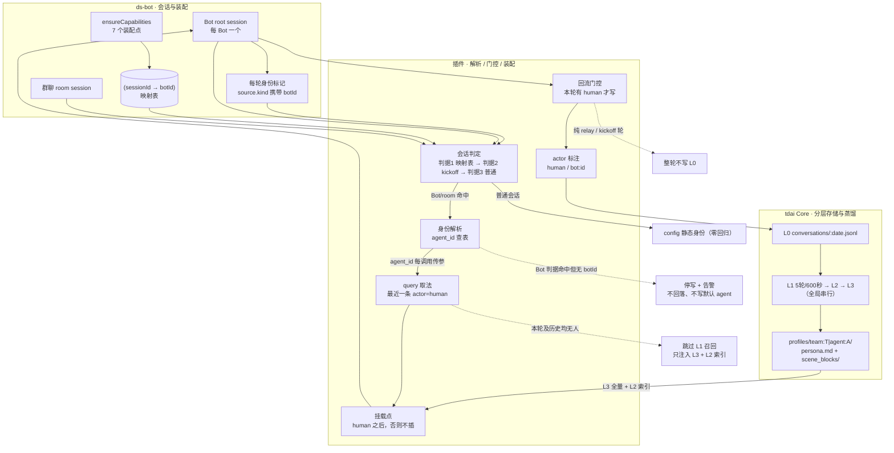

# 最终方案（r2）：以「会话身份 + 人机归因 + 角色化投影」接入 ds-bot


> ⚠️ **废案（2026-10-22 标记）**：本文件**不作为实施依据**，仅供查阅历史推导与被推翻的旧表述。
> 实施规格以 [minimal.md](./minimal.md)（人读）与 [minimal.agents.md](./minimal.agents.md)（执行层）为准；
> 时序证据见 [timing-probe.md](./timing-probe.md)。
> r1 合并自 `design-a.md`（框架，87 分）与 `design-b.md`（映射与失败策略，83 分）；本次 r2 补入“canonical 人物记忆 + scoped 角色观察”模型。评分与分歧见 `verdict.md`。
> 本文是设计结论，不是实现。
>
> **修订优先级**：§9 是 r2 的规范性设计，优先于本文此前所有“每个 Bot 默认拥有独立完整 L2/L3 人物画像”的表述。旧段落保留为 r1 的取证与实现背景，不再构成 r2 的行为要求。
>
> **r3 补入**（2026-10-19 晚）：① ds-bot 视为**不可修改的外部插件**，会话映射改读 `state.json`（§9.9）；② 角色定义的权威源与两类 Bot 的沉淀形态（§9.10）。§4.2 首层判据、§6.3、§8 第 3 条已同步更正——旧表述「state.json 里没有 sessionId」经实测证伪。
>
> **来源标记**：`[a]` 来自 design-a ｜ `[b]` 来自 design-b ｜ `[new]` 合并新补 ｜ `[r2]` 本次裁定
>
> ⚠️ **实现规格已迁移**：阶段一的实现契约见 [`r4.md`](./r4.md)（独立 CR 后的精简稿，含被推翻的旧表述清单）。本文与 r4 冲突处以 r4 为准。

---

## 决策摘要（r2）

| # | 决策 | 取值 | 理由 |
| --- | --- | --- | --- |
| 1 | 人物事实的主库 | **固定 canonicalAgent**，服务端返回 id 后持久化 | 同一用户只能有一份权威长期画像 |
| 2 | Bot 的独立 agent | **默认不建**；仅长期、领域明确的 `scoped` Bot 建 viewAgent | 防止同一人的 L3 分叉、冷启动和口径冲突 |
| 3 | Bot 自动产物 | **不写 canonical / view**；留在 ds-bot 工作记忆或日志 | 自动推断与工具轨迹不能长成人物事实 |
| 4 | 解析或映射失败 | **Bot/room 停写 + 告警**，不回落默认 agent | 防止错误归属污染 canonical |
| 5 | 首个实现步骤 | **修真人 query、actor 门控，再验证 L0 字段集** | 先保证“谁说的话”正确，后续路由才有意义 |

---

## 1. 判断 `[a]`

矛盾不在 tdai 侧：L2/L3 本就按 `team + agent` 隔离，新建 agent 即拿到独立场景块与画像（材料包 P1.1、P1.3）。矛盾在接入侧两处哑点叠加：

- 插件把 TDAI 身份当**进程常量**（底本 §5.1）；
- 插件用 `source.kind === 'user'` 认人（底本 §5.4），而 Bot 会话里一条 `kind='user'` 都没有（底本 §2.5）。

两个哑点落在同一条消息流上：**认不出「谁的会话」，也认不出「谁在说话」**。于是身份唯一、画像唯一、L0 里堆的是机器产出。

---

## 2. 选档与理由 `[a]`

| 档 | 内容 | 判断 |
| --- | --- | --- |
| 0 | 两者不同时使用 | 拒绝：三处冲突继续污染 L0 |
| 1 | 只回流会话结果、历史不回流 | 拒绝：L1/L2/L3 是聚合多条 L0 后异步蒸馏（材料包 P1.5），只喂结论不喂证据；且完全不动身份 |
| 2 | **本方案**：会话级身份解析 + 人机归因 + 门控回流 + 按 agent 装配 | 采用 |
| 3 | 每 Bot 一个 dsh 进程（天然一进程一身份） | 拒绝：与「Every Bot is one root Session」冲突，把进程内协作切碎 |

选档 2 的关键理由：**它不动协议**。`agent_id` 本来就是每次调用的请求参数（`recall.mjs:219-220`、`assets.mjs:206`），改的只是「从哪取值」；config 里的单一身份不删，降级为普通会话的回落值。

---

## 3. 架构图



### 责任边界

- **ds-bot**：会话归属与装配。新增「身份声明 + 映射写入」，不改团队模型、不改 turn 驱动。
- **插件**：解析、判定、门控、装配。新增「会话判定 + 身份解析 + actor 归因」，不改注入段序，不改协议。
- **tdai Core**：只负责分层存储与蒸馏，**本方案不需要它改任何东西**。

---

## 4. 机制设计（逐条对应 10 点）

### 4.1 三处冲突逐条回应（点 1）`[a]`

| # | 冲突 | 处置 |
| --- | --- | --- |
| 1 | 真人判定不一致（底本 §6.1） | 两个谓词合并为一个 `isHuman(msg)`。基线 = `role==='user' && (kind 缺省 \|\| kind==='user')`；**仅当会话已判定为 Bot/room** 时，再收 `user-question-reply`（卡片回答是人选的）。挂载点改为「本轮无 human 则不插」 |
| 2 | 回流白名单不匹配（底本 §6.2） | 白名单重写为「role + actor + 轮级门控」，见 4.3 |
| 3 | 身份粒度（底本 §6.3） | 不推翻「多身份不做」这个已否决决策，改的是取值来源：加载时读一次 → 每调用按会话解析 |

### 4.2 身份模型（点 3）`[a]+[b]+[new]`

**第一层：会话判定（先判断"这是谁的会话"）**

| 判据 | 内容 | 命中后行为 |
| --- | --- | --- |
| 1（首选） | 读 `~/.dsh/bot/state.json`：`sessionId ∈ bots` 或 `∈ rooms`（键名即 session id，见 §9.9） | 得到 botId / roomId |
| 2（兜底） | 会话内已出现 `kind='bot'` 的 kickoff 消息（`[Bot team setup]`） | **知道是 Bot 但不知是谁 → 停写 + 告警** |
| 3（都不是） | —— | 普通会话，用 config 静态身份 |

> `[new]` 判据 2 是本次合并补的。a 只有"映射表 → config 回落"两层，b 只有"声明 → 静态身份"，两者共同的漏洞是：**映射没写成时，Bot 会话会被当成普通会话处理，照样污染主画像**。用 kickoff 消息做兜底判据，能把这条漏水的路堵上。

**第二层：身份解析（botId → agent_id）**

`[b]` 建 Bot 时创建 TDAI agent，**持久化 `bot.id → 服务端返回的 agent_id`**。agent_id 不从名称拼接——`agentCreateSchema` 没有 `agent_id` 字段。

生命周期 `[b]`：

- 改名 / 改角色 / 换模型 → **不动映射**
- 删除 Bot → **只停用映射，不复用 agent_id**
- 映射创建失败 → 该 Bot 进入停写状态，不影响其它 Bot

**第三层：回落（只有普通会话走）**

`[new]` 把 a 的单层回落拆成两条：

| 会话类型 | 解析失败时 |
| --- | --- |
| 普通会话 | 回落 config 静态身份（= 今天的行为，零回归） |
| Bot / room 会话 | **停写 L0、跳过 L1 召回、保留 L3/L2 注入（只读）**，并打一条告警 |

### 4.3 回流策略（点 4）`[a]`

actor 三分：`human`（`user` / `user-question-reply`）、`bot:<id>`（assistant 文本与同 step 工具产出）、`host`（各注入块）。

**门控**：一轮写入 L0 的充要条件 = 该轮至少有一条 `actor=human` 的消息。纯 relay / kickoff / 定时触发的轮，整轮不写。

| | 内容 |
| --- | --- |
| 进 L0 | 人的原话；人的卡片选择（标 `human\|card`）；**被放行轮里的 bot 产出，标 `bot:<id>`，只作上下文** |
| 不进 L0 | `ds-bot-time-context` / runtime-context / skill-catalog / `[Bot team setup]` 等注入块；插件自身注入块；无人的整轮；reasoning |

标注方式三级（按可行性降级 `[a]`）：

1. 结构化 actor 字段写进 L0 —— **取决于 4.8 的前置验证**
2. 保底：role 位（human→`user`，bot→`assistant`）+ 正文前缀 `[actor=bot:<id>]`
3. 插件本地写入台账，供验收对账

⚠️ 不承诺 Core 抽取侧会尊重该标注（见 §6）。

### 4.4 注入契约（点 5）`[a]`

- **query**：L1 query = 本会话最近一条 `actor=human` 的文本；本轮无则回溯历史；历史也没有 → **不发 L1 请求**，只注入 L3 + L2 索引。改写点 `recall.mjs:281`。
- **挂载点**：插在本轮最后一条 human 消息之后；找不到则不插（`recall.mjs:369-370` 的 `messages.length` 兜底要改）。
- **预算**：段序与 order 不变（520/521/522）。**身份标记不进 system** —— system 是前缀，会话内易变字节进去就打穿缓存，这是硬约束。基线：Bot 会话 system 34,027 字符 vs 普通 23,275（+46.2%），tools schema 83,420。

> `[a]` 的一个额外洞察，本方案采纳：召回块插到末尾后，**下一轮的 `lastUserText` 会取到它自己**，形成自我召回。改挂载点顺带堵掉这条路（标【推断】，验收 A5 会证实或证伪）。

### 4.5 多 agent 的记忆归属（点 6）`[a]+[b]`

三个概念的理解：

- **tdai Agent**：纯元数据实体，Core 不托管不调度；唯一性 `team_id + agent_id`。它是**记忆归属的键**。
- **L2/L3**：`team + agent` 级 profile，不消费 sessionId；**L0/L1** 则是 `(team, user, agent, session)` 的行内字段。即「按 Bot 独立」在存储层已成立，缺的只是调用侧传对 agent_id。
- **ds-bot Bot**：root session + roster 记录，是**运行与装配单元**。

对应规则：

1. **一对一**：`Bot.id → agent_id`（服务端返回后持久化），按 `team+agent` 幂等创建。
2. **L2/L3 走默认归属**，运行时按当前 agent 读自身 profile。第一版不启用 Loadout。
3. **user 维度共用**：user_id 沿用 config 那一个；同一人的 L0/L1 分散在各 agent 名下。
4. **冷启动**：新 agent 的 L2/L3 从零长，不继承（「不继承」是推断 → 依赖缺口 5）。接受，不承诺继承。可选退路：把该 Bot 历史轮按 4.3 门控重放写入 L0，交给管道蒸馏。
5. **不做**：不把 Bot 的 `instructions` 同步进 `AgentEntity.prompt`（第一版不引入）。

**群聊（张力 5）** `[a]`：每个 room 建独立 agent。人的发言与房间上下文落在它名下。拒绝「落进各参与 Bot」——同一段对话被 n 个 agent 各蒸馏一遍，成本 ×n，L3 全局串行还会互相排队，房间发言也会污染各 Bot 画像。代价：Bot 在群里说的话不进它自己的 L2/L3，需要时借入 room agent 的资产。

### 4.6 兼容与回滚（点 7）`[a]+[b]`

唯一行为分叉点是**「本会话的会话判定结果」**：

- 判为普通 → 旧谓词、旧挂载、旧白名单、config 身份，即今天的行为
- 判为 Bot/room → 新路径；解析不出 botId 则停写
- 总开关：关闭后全量回到今天的行为

数据侧不删任何东西：actor 标注与新建 agent 目录都是增量。system prompt 保持不变（底本 §2.4 实测 ds-bot 未改插件注入内容）。

### 4.7 落地步骤（点 8）`[a]+[new]`

**第 0 步（新增前置，≤30 分钟，不做完不许开工）** `[new]`

验证 `/v3/conversation/add` 接受哪些字段：

- 是否支持结构化 `actor` / 自定义 metadata？
- 若只接受 role + content，则 4.3 的标注降级到第 2 级（role + 正文前缀）

判定：直接向本机 gateway 发一条带 actor 字段的 L0，再用 `/v3/conversation/query` 读回，看字段是否保留。**这一步失败，整个标注策略要重定，所以放最前。**

**第 1 步（≤1 小时，只做身份可见性）** `[a]`

ds-bot 在 Bot 会话的身份标记里加 `botId`；插件在 pre-step 解析并打一行 stderr：`resolved bot=… via=marker|map|none`。

判定：开 Bot A、Bot B 各说一句，再开一个普通会话说一句 → 三行日志必须是 `A / marker`、`B / marker`、`none`。全中即成功。

**第 2 步** 谓词与挂载点统一（Bot 分支生效）：日志打印 L1 query 前 40 字符。判定：query = 人的原话且 ≠ 任何注入块文本；纯 relay 轮无召回请求。

**第 3 步** 回流门控 + actor 标注：判定见 A3。

**第 4 步** 身份路由生效（agent_id 查表 + 建 agent）：判定见 A1。

**第 5 步（可选）** room agent、历史引导回流、Loadout 借入。

### 4.8 风险与代价（点 9）`[a]+[b]`

| 风险 | 说明 | 缓解 |
| --- | --- | --- |
| L1 阈值 5 轮 / 600 秒 | 验收必须等阈值触发，「说完就查」一定查不到 | 脚本按 600 秒设计等待 |
| L3 全局串行 `concurrency=1` | n 个 Bot 同时冷启动会排队 | 分批上线，不并发建 |
| 提示词预算 | Bot 会话 system 已 +46.2%；再叠加每 agent 一份 L3 全量注入 | 身份标记不进 system；L2 只进索引 |
| 抽取语义不受控 | actor 标注是写入侧的，Core 是否据此区分人机未知 | 记为待验证项；A3 先验证写入侧 |
| 已否决决策的复访 | 「多身份不做」是记录在案的否决 | 本方案只加解析层，不改 config 语义；过会时带这套理由 |
| 数据放大 | 门控只保证纯机器轮不写；有人介入的轮里 bot 产出仍进 L0 | 接受；`vectors.db` 已 61 MB，需监控 |
| 映射运维状态 | 每个 Bot/room 多一条映射记录 | 映射与 Bot 生命周期同源，删除即停用 |

依赖缺口的退路见 §8。

### 4.9 验收方法（点 10）`[a]+[b]`

标记串穿透测试：Bot A 说 `紫色考拉`，Bot B 说 `橙色水獭`。

| # | 通过的样子 | 不通过的样子 |
| --- | --- | --- |
| A0 映射稳定 `[b]` | 重启、改名、换模型、换角色后 `bot.id → agent_id` 不变；同名新 Bot 拿到不同 agent_id | 映射漂移或复用 |
| A1 隔离 `[a]` | 各跑 ≥6 轮或等 600 秒后，`profiles/` 出现两个目录；A 的 persona 与场景块含「紫色考拉」不含「橙色水獭」，B 反之 | 只有一份 profile；或串写 |
| A2 召回隔离 `[a]` | 在 A 会话问一句与两串都相关的话，L1 召回只出 A 的标记串 | 出现 B 的 |
| A3 人机标注与门控 `[a]` | 造一轮纯 relay：当日 L0 行数不变；再造一轮人提问 + Bot 长回答：人的消息在、bot 产出带 actor 标注且不冒充人 | relay 轮写进 L0；或人提问轮里人的消息缺失 |
| A4 普通用户无回归 `[a]` | 改动前后同一普通会话跑同样两轮：system prompt 逐行相同、召回块相对顺序不变、L0 角色分布一致 | 任一处 diff |
| A5 query 正确性 `[a]` | 日志里 L1 query = 人的原话（前 40 字符）且 ≠ 任何注入块文本；无人的轮无请求 | query 是注入块或召回块自身 |
| A6 失败即停写 `[new]` | 手工删掉某 Bot 的映射后跑一轮：该 Bot 的 L0 行数不变，且出现告警 | 内容写进了主 agent |
| A7 预算 `[a]` | 改动后 Bot 会话 system 字符数与 34,027 同级，不因身份注入增长 | 涨了说明有东西进了 system |

---

## 5. 落地顺序与工时（估算）

| 步骤 | 内容 | 估时 | 可回滚 |
| --- | --- | --- | --- |
| 0 | 验证 L0 写入字段集 | 0.5h | 只读 |
| 1 | 身份标记 + 解析日志 | 1h | 开关关闭即回滚 |
| 2 | 谓词与挂载点统一 | 2h | 同上 |
| 3 | 回流门控 + actor 标注 | 3h | 同上 |
| 4 | agent 映射 + 身份路由 | 3h | 停用映射即回滚 |
| 5 | room agent / 历史重放 / Loadout | 按需 | 独立开关 |

合计到第 4 步约 **9.5 小时**，不含验收等待（L1 阈值 600 秒 × 多轮）。

---

## 6. 我不确定的（诚实清单）

1. **写 L0 的请求体字段集**（最可能否掉标注的一环）——第 0 步专门验它。
2. **身份标记能否每轮注入**：材料只写 `Current time` 每 10 分钟刷新，没写它是每轮发还是只在刷新时发。若只在刷新时发，判据 1 会漏，只能靠映射表。
3. **映射表落点**：`state.json` 的 `bots`/`rooms` 键名就是 session id（§9.9 已实测），不再是未知项；待定的只是插件自建的 `bot-agents.json` 放哪。
4. **Core 抽取提示词是否尊重写入侧 actor 标注**。这决定冲突 2 是否真的被解决。
5. **普通会话里** `user-question-reply` 与 `ask_user_question` 回答的 `source.kind`，未取证。
6. **召回块自身的 `source.kind`** 以及它会不会被 `lastUserText` 取到——4.4 的自我召回是【推断】。
7. **room session 的 id 在插件侧是否可取**（room agent 的前提）。
8. **新建 agent 的 L2/L3 是否真的不继承**（材料包缺口 5）。
9. **新 agent 首次 L3 的实际体量**：21,237 B 是本机唯一 profile 的观测，不能外推。
10. **同 session 切换 agent_id 后 L0 归属**（材料包缺口 2）——本方案用「一次会话一个 Bot」规避，但未实测。

---

## 7. 与两份初稿的差异汇总

| 项 | design-a | design-b | 本稿 | 取谁 |
| --- | --- | --- | --- | --- |
| agent_id 来源 | 从 bot.id 派生 ❌ | 服务端返回后持久映射 ✅ | 同 b | **b** |
| 解析失败 | 回落 config | Bot 停写 | 拆成两条：普通回落 / Bot 停写 | **b + 新** |
| 会话判据 | 标记 + 映射表 | 声明 | 加第三判据「kickoff 兜底」 | **新** |
| L0 留不留 bot 产出 | 留，标 actor | 一律不写 | 留，标 actor | **a** |
| 门控规则 | 充要条件=有 human | L0 仅写 human 块 | 同 a | **a** |
| 验收矩阵 | A1–A7 | 4 条要点 | A0–A7（并入 b 的映射稳定性） | **a + b** |
| 第一步 | 身份可见性 20 分钟 | 影子解析 60 分钟 | **前置验证 L0 字段 → 身份可见性** | **新** |
| 群聊 | room agent + 拒绝理由 | room agent | 同 a（论证更完整） | **a** |
| 生命周期 | 无 | 改名/删除不动映射 | 同 b | **b** |

### 7.1 演化记录（r1 → r3）

| 阶段 | 触发 | 核心结论 | 对方案的影响 |
| --- | --- | --- | --- |
| **r1**（2026-10-19 上午） | 双模型初稿评判（`verdict.md`）后合并 | 取 design-a 的框架（三层解析、门控、A1–A7 验收），取 design-b 的映射与失败策略 | 形成首版 final。此时仍假设「每 Bot 一个独立 agent」且「需要 ds-bot 配合写标记」 |
| **r2**（2026-10-19 下午） | 追问「Bot 定位与 tdai agent 定位是否重叠」+ 两类 Bot 的沉淀形态 | 同一用户只能有一份权威人物画像，N 份独立 L3 只会分叉。改为 **canonicalAgent（固定主库）+ scoped viewAgent（仅长期领域角色）+ ds-bot 工作记忆** 三层，「每 Bot 一个独立 agent」不再是默认目标 | 新增 §9（规范性），取代 §4.5 的「所有 Bot 一对一独立 L2/L3」；决策摘要改为 r2 版 |
| **r3**（2026-10-19 晚） | 确认 ds-bot 当**外部插件**、不可修改 | 会话映射不需要 ds-bot 配合：`state.json` 的 `bots`/`rooms` **键名就是 session id**，只读即可。角色定义权威留在 ds-bot，tdai 的 `AgentEntity.prompt` 留空。执行者=`shared`、拟人=`scoped` 显式化 | 新增 §9.9 / §9.10；§4.2 首层判据、§6.3、§8 第 3 条同步更正（旧表述「state.json 里没有 sessionId」经实测证伪） |

> 三条仍未改动的地基：① 不改 tdai Core；② 不改 ds-bot；③ 插件是唯一可动的一侧。r1→r3 的全部变化都发生在这个约束内。

---

## 8. 待你拍板的三个点

1. **第 0 步的验证由谁做、什么时候做**？它决定 4.3 的标注能不能用结构化字段。我可以现在就写一个 20 行的探针脚本。
2. **群聊要不要在第一版就做**？a 和 b 都设计了 room agent，但它让第一版的 agent 数量翻倍（Bot 数 + 群数），且 L3 串行会排队。建议第一期只做 Bot，room 留到第二期。
3. **`agent_id` 映射的持久化位置**：`state.json` 只读不写（§9.9），映射另存 `bot-agents.json`；放 `~/.dsh/` 还是插件自己的数据目录，待定。

---

## 9. r2 裁定：Canonical 人物记忆、角色化投影与 ds-bot 工作记忆 `[r2]`

> 本节取代 §4.5 的“所有 Bot 默认一对一独立 L2/L3”作为产品语义；§4.1–4.4 的会话识别、人机归因、召回 query 与注入挂载修复仍保留，且是 r2 的前置条件。

### 9.1 结论

不修改 TencentDB-Agent-Memory Core，也不修改其 L3 蒸馏规则。角色化投影由插件完成：**改变消息写往哪个既有 TDAI agent，以及一次请求合并读取哪些 agent 的已有资产。**

“每个 Bot 一个独立 agent”不再是默认产品目标。若把每个 Bot 的完整人机对话都写入各自 agent，它们会各自蒸馏出一份“关于同一个人”的 L3；这些画像会冷启动、异步滞后、互相矛盾，且没有权威裁决者。这不是投影，只是分叉。

r2 定义三层，不互相同步：

| 层 | 归属与内容 | 主库 / 权威 | 生命周期 |
| --- | --- | --- | --- |
| **canonical 人物记忆** | 用户稳定事实、偏好、边界、已确认决策；仅来自真人输入、卡片选择和已确认纠正 | 一个固定 TDAI `canonicalAgent` | 跨 Bot、跨会话；人物事实唯一真相源 |
| **scoped 角色观察** | 某长期角色在其领域中看到的、命中 scope 的真人对话与已确认例外 | 可选 TDAI `viewAgent`，仅对应一个 Bot | 可停用、可重建；只能作领域工作假设 |
| **团队工作记忆** | 任务状态、分工、交接、Bot 角色规则、工具过程和团队结论 | ds-bot `MEMORY.md` / checkpoint / 会话日志 | 跟随团队与任务；允许快速改写或过期 |

同一条信息只能有一个主库；另一侧最多保留来源引用，**不得自动双向同步**。

### 9.2 角色化投影不是“另写一个 L3”

投影的含义是：Bot 每轮只接收会改变它当前判断的那部分人物信息。它由 `Bot memory profile` 声明，而非由 Core 改造实现：

```yaml
memoryMode: shared | scoped
scopes: [collaboration, project] # 仅 scoped 时生效
canonicalRead: profile-and-recall
viewRead: none | recall-and-profile
```

- `shared`：默认。只读 canonical 人物摘要与当前真人问题的相关召回；**不创建 viewAgent**。短生命周期的研究员、调查员、代码执行者应使用此模式。
- `scoped`：只给稳定、跨多轮、领域明确的角色使用。它同时读取 canonical 和自身 viewAgent，但 view 内容被标为“领域观察，非人物事实”。适用例：长期投资审计、健康教练、关系教练。
- `scopes` 决定哪些**真人**输入可额外进入 viewAgent，例如 `finance`、`health`、`collaboration`。scope 未命中时不写 viewAgent。

这让不可修改的 Core 按原规则蒸馏：canonical 的输入天然形成完整人物画像；viewAgent 因输入已被插件限域，天然形成领域观察。插件不把后者作为第二人物真相源注入。

### 9.3 写入路由与人机归因

每轮先执行 §4.1 的统一 `isHuman`，再按如下路由：

| 输入 / 产物 | canonicalAgent | viewAgent | ds-bot memory |
| --- | --- | --- | --- |
| 真人原话、卡片选择、真人纠正 | 写入（经现有回流门控） | 仅 scope 命中时写入 | 若影响本团队执行，可记执行引用 |
| Bot 的自动回复、Bot 间 relay、工具轨迹、推理 | 不写 | 默认不写 | 写入或保留在当前任务日志 |
| Bot 发现的长期事实候选 | 不直接写 | 可作为待确认观察，或不写 | 留在任务结论，等待用户确认 |
| 用户明确采纳的长期规则 | 写入 | scope 命中时可写 | 若约束团队执行，记一条引用规则 |

因此，Bot 的自动化过程不会反向长成 canonical 人物画像；用户在协作过程中的真正介入不会丢失。§4.3 的 `actor=human | bot:<id> | host` 标注仍应保留，用于审计和后续 Core 行为取证。

### 9.4 读侧组合、标记与冲突优先级

插件在 Bot 会话 pre-step 依次：

1. 从当前 `sessionId` 解析 Bot；普通会话继续走旧的静态身份，保持零回归。
2. 读取 canonicalAgent 的小型 L3 人物摘要，并以当前真人问题查询其相关 L1/L2。
3. 仅当 `memoryMode=scoped` 时，再读该 Bot 的 viewAgent；注入段标题必须表明“领域观察 / 非权威”。
4. ds-bot 自己继续注入角色、`MEMORY.md` 和 handoff；插件不写回这些内容。

冲突时的强制顺序：**当前真人消息 > canonical 人物事实 > scoped 领域观察 > ds-bot 团队记忆 > Bot 推断**。低层内容不能覆写高层内容；Bot 发现冲突时应显式报告，而不是悄悄选择一边。

注入预算也按此控制：所有 Bot 都可得到小型 canonical 摘要；L2 只给索引或工具按需读取；viewAgent 只对 scoped Bot 开放。这比“每 Bot 全量 L3 + L2 索引”更符合 Bot 会话已有较大 system 预算的现实。

### 9.5 ds-bot memory 与 tdai memory 的关系

两者不是竞品，也不是备份关系：

| 信息类型 | 主库 | 是否进入 tdai |
| --- | --- | --- |
| 当前任务状态、分工、失败重试、交接 | ds-bot | 否 |
| Bot 角色规则、团队工作约定、工具过程 | ds-bot | 否 |
| 用户稳定偏好、约束、已确认事实 | canonical TDAI | 是 |
| 某领域中用户的长期模式或确认例外 | scoped TDAI | 是，但仅该 scope |
| Bot 自动生成的方案、讨论和检索过程 | ds-bot / 会话日志 | 默认否 |

例：用户说“改已有产物前先给方案确认”。canonical 保存它是用户协作偏好；ds-bot 仅在该团队需要遵守时记录一条带来源的执行规则。例：投资 Bot 得出“本次不宜加仓”，它只属于团队任务结论；只有用户后来明确将其升格为长期约束，才进入 canonical。

禁止事项：

- 不把 canonical L3 自动复制到 ds-bot `MEMORY.md`；这会产生两个同时声称权威的版本。
- 不把 ds-bot 的日常 memory review 或 Bot 自动产物整批回灌 TDAI；这会把代理猜测和执行噪声写成人物事实。
- 不让 viewAgent 直接更新 canonical；提升必须来自用户确认，或满足后续另行定义的“充分真人证据”规则。

### 9.6 身份映射与最小实现

现有 §4.2 的 `Bot.id → agent_id` 映射在 r2 中保留，但语义改变：

- 固定 `canonicalAgent`：团队首次启用时创建一次，`agent_id` 由服务端返回并持久化。
- `viewAgent`：仅在某 Bot 显式配置为 `memoryMode=scoped` 时创建；同样持久化服务端返回的 id，绝不从 `bot.id` 派生。
- `shared` Bot 不需要 TDAI 的独立 agent 映射；它使用 canonicalAgent 读侧，且它的自动输出不写入 canonical。
- 映射缺失或解析失败：Bot / room 会话停写并告警，绝不回落写默认 agent；canonical 读侧可按现有 fail-open 策略降级，但不应伪造归属。
- 群聊第一期不创建 room agent。群聊仍由 ds-bot 管理；确有跨会话、由真人主导的长期主题时，再单独评估 room scope 与成本。

### 9.7 分阶段落地与验收改写

1. **保留 r1 基础修复**：完成 §4.4 的真人 query 与挂载点修复，完成 §4.3 的 actor 标注和“纯机器轮不写”。
2. **先只做 canonical**：创建并持久化一个 canonicalAgent；在一个 Bot 和一个普通会话中验证真人事实可跨会话召回，且 Bot 自动输出不污染其 L0/L3。
3. **一个 scoped 试点**：只为一个长期领域 Bot 开启 viewAgent 和一个 scope；验证它获得的领域观察不会进入 canonical，也不会注入其他 Bot。
4. **按收益扩展**：以“是否减少重复询问、是否避免领域特有的错误判断”为准，而不是按 Bot 数量扩张。

新增验收：

- **R2-A1 单一人物真相**：两个 shared Bot 与普通会话读取到相同的 canonical 约束；不存在各自独立完整人物画像。
- **R2-A2 scope 隔离**：投资 viewAgent 的内容不出现在健康 Bot 的注入或 canonical 中。
- **R2-A3 人机隔离**：长 Bot 自动回复和纯 relay 不改变 canonical 的 L0/L3；用户确认后的规则才可见。
- **R2-A4 团队隔离**：ds-bot 任务交接不会自动进入 TDAI；TDAI 人物事实不会被自动写成 `MEMORY.md`。
- **R2-A5 冲突可解释**：制造 canonical 与 view 不一致的受控样本，Bot 输出必须点出冲突并服从优先级，不得静默选边。

### 9.8 仍待验证的约束

- Core 的 L0 写入是否能可靠保留 `actor` 或 metadata；若不能，使用 role + 正文前缀和插件台账，但继续把它当作未解决的抽取语义风险。
- canonicalAgent 是否能以“仅真人输入”保留足够上下文供现有 L1/L2/L3 管道正确蒸馏；若不足，不应立即把 Bot 全文回灌，而应先验证最小上下文封装。
- 现有 `agent-fixed-asset` 是否能让 shared Bot 直接绑定 / 借入 canonical 的 chat memory；若不能，插件在 pre-step 做双 recall 再合成注入，仍无需修改 Core。
- scoped view 的实际收益是否覆盖 L1 5 轮 / 600 秒与 L3 全局串行带来的冷启动成本；试点失败即停用而非继续铺开。

---

### 9.9 不可修改 ds-bot 的前提与会话映射实现 `[r3]`

> 本节取代 §4.2 第一层里「由 ds-bot 在装配点写入映射表」的做法。§4.2 的其余部分（kickoff 兜底、失败停写、普通会话回落）不变。

#### 9.9.1 前提

ds-bot 当**外部插件**对待：不读它的内部 API、不给它加钩子、不写它的文件、不改它的代码。插件唯一能依赖的是它**落在磁盘上的产物**。

#### 9.9.2 映射源：`state.json`

【实测】`~/.dsh/bot/state.json`：

```json
{
  "version": 1,
  "mainBotIds": ["session-d91212ec-…"],
  "bots":  { "session-d91212ec-…": { "id": "session-d91212ec-…", "name": "Chief",
                                      "role": "Chief of Staff", "instructions": "…" } },
  "rooms": { "session-84cb5d01-…": { … } }
}
```

**`bots` 的键名、以及记录里的 `id` 字段，是同一个 session id。** 这是「Every Bot is one root Session」（`ds-bot/index.js:1`）的直接后果——ds-bot 自己就把身份和会话焊死了。所以映射不用问它要，它已经写在文件里。

#### 9.9.3 判定链（替代 §4.2 第一层）

| 判据 | 动作 | 结果 |
| --- | --- | --- |
| 1 | `sessionId ∈ bots` | botId = sessionId |
| 2 | `sessionId ∈ rooms` | roomId = sessionId |
| 3 | 会话里已出现 `kind='bot'` 且 `role='kickoff'` 的消息 | **是 Bot 但拿不到 id → 停写 + 告警** |
| 4 | 以上都不命中 | 普通会话，config 静态身份 |

#### 9.9.4 四个必须处理的坑

1. **懒保存**：ds-bot 用 `rt.save()` 异步写，刚建的 Bot 可能延迟几秒才出现。容忍，下次 pre-step 重试。
2. **删除即消失**：Bot 删除后从 `state.json` 消失。`bot-agents.json` 里的映射**只停用不复用**，否则同名新 Bot 会挂到旧画像上。
3. **私有格式**：它带 `version: 1`，无向后兼容承诺。解析失败一律 fail-open，走普通会话路径。
4. **只读不写**：写它等于跟 ds-bot 抢所有权，它升级必踩。

#### 9.9.5 对 §9.6 的影响

§9.6 说「现有 §4.2 的 `Bot.id → agent_id` 映射在 r2 中保留」——保留，但**来源改为本节的 `state.json`**，且只对 `scoped` Bot 有意义（`shared` Bot 不建 viewAgent，见 §9.2）。

---

### 9.10 角色定义的权威源与两类 Bot `[r3]`

#### 9.10.1 权威源：角色只在 ds-bot 定义

tdai 的 `AgentEntity` 有 `name` / `description` / `prompt` 三个字段，与 ds-bot 的 Bot 记录（name / role / instructions）在语义上完全重叠。

**裁定**：人设文本的权威源是 ds-bot。tdai 侧：

- `name` = Bot 名（给 Memory Hub 里的人认）
- `description` = 岗位语义，例如「执行者 · 投研；记忆偏市场判断与风险偏好」
- **`prompt` 留空**

理由：两边各写一份人设，一旦 Bot 的 `instructions` 改了而 agent 的 `prompt` 没改，模型会收到两份互相打架的自我描述。这种错误比记忆冲突难查得多——它不会报错，只会让 Bot 行为变得不可预测。

#### 9.10.2 两类 Bot 与 r2 的 shared / scoped 是对应的

| | 执行者（研究员 / 调查员 / 代码执行者） | 拟人角色（巴菲特 / 健康教练 / 关系教练） |
| --- | --- | --- |
| r2 模式 | **`shared`**（§9.2 原文即点名这类 Bot） | **`scoped`** |
| 人格在哪 | ds-bot instructions，薄 | ds-bot instructions，厚（可能上千字） |
| tdai 侧角色 | 经验槽 | 判断槽 |
| 主要沉淀形态 | **Skill**（可复用流程，team 可见） | **L2 场景块**（情境 → 判断 → 结果） |
| L3 里写什么 | 这个人关心什么议题、验收标准 | 这个人的风险偏好、决策风格、对什么说法不买账 |
| 失效方式 | 流程过时 | **被人格驯化**（见下） |

#### 9.10.3 拟人 Bot 的独有风险：被驯化

巴菲特 Bot 说「这票不该买」，用户回「但我看好它的成长性」。若 tdai 记成「用户偏好成长股」，下次它会自动迎合——人格就没了，只剩一个学巴菲特语气的应声虫。

**正确记法**：记「这个人在成长股上有独立判断，与该框架冲突时会反驳」——**关于关系的记忆，不是关于喜好的记忆**。

对应到 r2 的三层：这类内容属于 **scoped viewAgent** 的领域观察，**不进 canonical**。因为「用户会反驳这个框架」不是人物事实，是这组角色关系的属性。

#### 9.10.4 拟人角色的三层构成

```
人格层 · ds-bot instructions      方法论、语气、判断偏好（稳定，不随对话变）
方法层 · tdai Skill 资产          可执行的判断流程（可复用，可被其他 Bot 借入）
关系层 · tdai scoped viewAgent    这个人在这框架下的反应模式（哪些话他认、哪些会顶回来）
```

三层各归各的：人格放 tdai 会被稀释（L3 是学出来的，不能覆盖写死的）；方法放 instructions 可惜（skill 能被第二个 Bot 借，instructions 只属于一个 Bot）；关系放 ds-bot 的 MEMORY.md 会丢（它每轮复盘、模型自由增删，学不出这种慢变量）。

#### 9.10.5 新增验收

- **R3-A1 角色不漂移**：改动 Bot 的 `instructions` 后重启，tdai 侧 `AgentEntity.prompt` 仍为空，且注入中不出现第二份人设。
- **R3-A2 执行者沉淀为 Skill**：一个执行者 Bot 跑通一次调研后，流程被提炼成 team 可见的 Skill，第二个执行者 Bot 能借到。
- **R3-A3 拟人角色不被驯化**：对拟人 Bot 连续三次用相反观点反驳；三次后它的判断框架不变，且 scoped view 里出现的是「用户会反驳」而非「用户偏好 X」。
- **R3-A4 state.json 兜底**：手工把一个 Bot 从 `state.json` 删掉后跑一轮，该会话停写并告警，内容不落 canonical。
