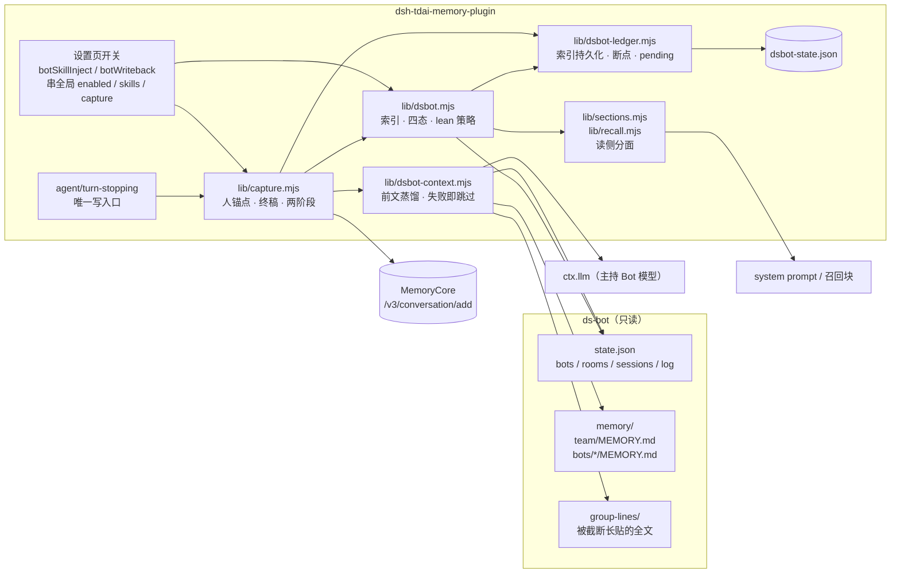
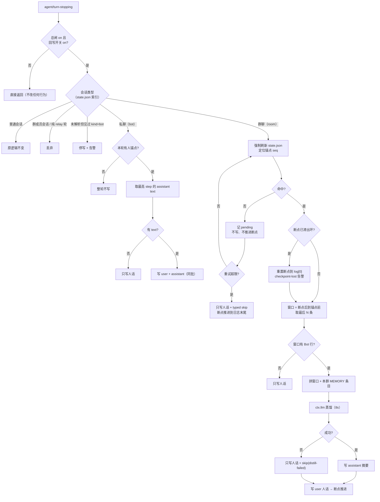
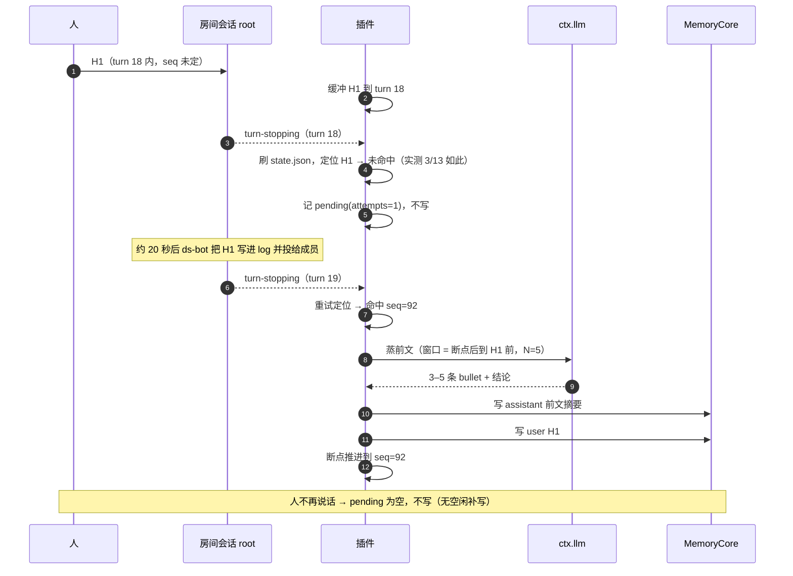

# 最小集成：lean 读侧与按人锚点写回合

> 负责人：Tim ｜ 日期：2026-10-22 ｜ 状态：**已实施（r3）**，实施偏差见文末「实施记录」
> 相关：[r4 阶段一规格](./r4.md)（废案，仅参考）｜[总方案 final](./final.md)（废案）｜[取证底本](../../ds-bot-alignment-evidence.zh-CN.md)｜[时序实测](./timing-probe.md)
> 图源：[架构图](./diagrams/minimal-architecture.mmd)｜[流程图](./diagrams/minimal-flow.mmd)｜[时序图](./diagrams/minimal-sequence.mmd)

本稿是 r4 的一个更小、能先落地的子集：只做「Bot 会话不再注入身份与记忆、只留 skill 注入」和「只写人参与的回合」。与 r4 冲突处，在本稿范围内以本稿为准；r4 与 final 已标废案，只作参考。

**r2 改了什么**：写入钩子与「一轮」的定义写死到 `agent/turn-stopping`；群聊锚点改成两阶段（轮末尝试 → pending → 重试 → 放弃）；台账补状态机与损坏语义；身份索引改持久化、不再按 cwd 推断。依据全部来自 [timing-probe.md](./timing-probe.md) 的实测，不是推测。

## 1. 结论

改两件事，读写各一件。

- **读侧按会话分面。** Bot 会话、群会话、群成员隐藏会话一律 lean：`identity=false`、`memory=false`、`skills=true`、`knowledge=true`。实测 system prompt 里白背 7,339 字符 `<session_context>` 与 3,158 字符 `<tdai_profile_memory>`；云端 skill 在 relay 驱动的会话里 query 恒空（`buildSkillQuery([relay])` 返回空串）。注意 `knowledgeEnabled` 默认是 **false**（`config.mjs:156`、`lib/settings.mjs:104`），本稿不改默认值。
- **写侧按人锚点写回合。** 私聊一轮写两条：人话 + 终稿。群聊每条人消息写两条：自蒸前文摘要（assistant）+ 人话（user）；窗口为空时只写人话。relay、注入块、工具调用、纯 Bot 互投轮一条不写。
- **写入时机是 `agent/turn-stopping`，不是消息到达。** 一轮 = 一次 turn-stopping；人话在自己那一轮的轮末提交。实测真人消息全部落在已打开的轮内但事件不带 turn 字段（22/22），所以只能按 `currentTurn` 归属。
- **群聊锚点两阶段。** 轮末先尝试在 room log 定位；**实测 13 条锚点里 3 条要晚 22–23 秒才进 log**，所以定位失败不是异常：挂 pending，下一次 turn-stopping 重试，超限则只写人话并跳过前文。
- **两个开关受全局钳制。** 设置页新增「Bot 会话注入云端 skill」与「Bot 会话回写记忆」两个开关：前者默认开、与 `enabled`+`skillsEnabled` 做 AND；后者默认关、与 `captureEnabled` 做 AND。全局关掉时子开关自动失效并在面板置灰。**Bot 会话的身份与记忆恒不注入**——角色权威归 ds-bot，且本阶段没有每 Bot 一个 agent；所以注入面里真正给 Bot 的只有 skill（与知识工具）。
- **失败一律只写人话。** 蒸馏超时、报错、空输出、窗口不可用、锚点始终定位不到——这几种情况都不再写任何「兜底原文」，只写人话并记一条 typed skip。写侧的底线是「宁可少写，不写错」。
- **群聊没有现成终稿可抄。** 实测 room root 的 129 个 completed 轮**全部**没有文本（每轮都是一次 `group_relay` 工具调用），只能自蒸；ds-bot 的 `memory.js` 是游标式长期复盘，没有按轮摘要可复用。

已按你的四条决策定稿：① 群聊取前 N 条蒸上下文；② 蒸馏用主持 Bot 的模型；③ 人不再说话就不写，不做空闲补写；④ 台账路径可配，默认在插件自己的 storages 下。

三条待定已全部落定：① 失败轮与蒸馏失败一律**只写孤立人话**（不再有「降级写原文」这条路径）；② Core 的写入顺序按数组、不按 timestamp 排序（`v2-router.ts` 只做批量插入），每条记录带 timestamp，顺序可预期；③ 蒸馏调用形状已用脚本核过 17 条断言（`scripts/verify-llm-api.mjs`）。本稿要你批的只剩范围与工时（§10，约 33.5 小时）。

刻意不改：

- 不建每 Bot 一个 tdai agent，不做身份映射；所有写入仍进现有 canonical agent。
- 不做历史会话全量回流。
- 不改 ds-bot 源码，不写 `~/.dsh/bot` 下任何文件（含台账、临时文件、日志），只读。
- 群聊不写 Bot 终稿原文：终稿以摘要最后一条「结论：」表达。
- Bot 会话不写 `/v3/skill/conversation/add`。
- 不按 cwd 推断 Bot 会话（实测会反向错判，见 §3）。
- 不为了「窗口好看」调大 `ROOM_LOG_MAX`，只做检测与降级。

## 2. 名词解释

| 词 | 负责什么 | 不负责什么 |
| --- | --- | --- |
| 人锚点 | `role=user` 且 `source.kind ∈ {user, user-question-reply}` 的消息；一条锚点定义一次写入回合 | 不定义 Bot 怎么回，也不代表一定被写（要看会话类型） |
| 回合 | 一次 `agent/turn-stopping`；人话与终稿都在这个回合的轮末提交 | 不等于「用户说一句到 Bot 回完」的直觉回合 |
| 终稿 | 该回合内**最高 step** 的 assistant text 块合并 | 不含中间步骤文本、工具调用与思考；群聊没有终稿 |
| 前文 | 群聊里上次已写入之后、本条锚点之前的 room log 记录，最多 N 条 | 不是长期画像，也不跨房间 |
| pending | 已确认是锚点、但当轮还没能在 log 定位到的那一条；带重试计数 | 不是写入队列，不持有记忆内容之外的任何东西 |
| 主持 Bot | `rooms[*].admin` 指向的 Bot；缺失时取 `members` 里第一个存在的 Bot | 不参与写入，也不决定写什么 |
| 环覆盖 | room log 只有 60 行，旧行被挤掉；断点可能整体滑出 | 不是丢数据故障，是既定容量 |
| lean 读侧 | 只给知识面与 skill 面的读侧策略 | 不关闭工具注册，只关闭注入与召回 |
| 台账 | 插件自己的索引、断点、pending 与幂等记录（`dsbot-state.json`） | 不存记忆内容；不写 ds-bot 目录 |

## 3. 思路分析

约束（前三条是 CR 前就有，后三条来自 [timing-probe.md](./timing-probe.md) 实测）：

- ds-bot 不可改，只能读 `state.json`、`memory/`、`group-lines/`。
- L0 写入只有 `role / content / timestamp`，没有 actor 字段；服务端不提供客户端记录 id，去重只能靠插件台账。
- 群聊没有天然的终稿对象：只有 room log 是共同视图，而它只存 60 行、无时间戳。
- **钩子只有一条**：`agent/turn-stopping` 在成功路径派发、且在 `turn/end` 之前；异常轮不经过它（`dsh-agent-loop/lib/index.js:997-1030`）。
- **锚点可能晚于轮末入 log**：10/13 在轮末前，3/13 晚 22–23 秒；38% 的旧锚点已被环覆盖。
- **房间会话没有文本**：129/129 无 text，群聊终稿只能自蒸。

四个选项：

| 选项 | 做法 | 结论 |
| --- | --- | --- |
| A 全量回流 | 会话里所有消息都写 | 否。74% 字符是 relay，Bot 的话会被抽成用户画像 |
| B 只写人话 | 只写 `kind=user` | 否。「继续做完」离开上文不可解，L1 抽不出东西 |
| C 按人锚点写回合 | 人话 + 终稿；群聊加前文摘要 | 选它。归因干净；L1 阈值按 `role=user` 条数计（`v2-router.ts`），每条锚点 1 条 user ⇒ 约 5 条锚点触发一次 |
| D 每轮统一摘要 | 轮末由插件蒸一次，人话也并进摘要 | 否。与 Core 的 L1 重复蒸馏，两套口径难排查 |

C 里唯一需要再选的，是「锚点还没进 log 时怎么办」：

| 做法 | 后果 |
| --- | --- |
| C1 找不到就只写人话、跳过前文 | 丢掉 23% 的上下文，且那几轮恰是真人明确发言的轮次 |
| C2 挂 pending，下一轮重试；超限再放弃 | 选它。多写一次定位，换取上下文的完整 |
| C3 到场即读、等 log 出现（忙等/定时器） | 否。与「不做空闲补写」的决策冲突，还引入定时器 |

群聊为什么蒸、不贴原文：117 条 room 块共 489,699 字符，占全部入站字符 55%；原文进 L0 会淹没真实对话，也会把 Bot 的措辞带进抽取语料。

为什么不做每 Bot 一个 agent：同一个人的 L3 会分成五份，冷启动与口径冲突都要单独治理。本阶段先把「人」写对，隔离放 §9。

为什么身份索引不能靠 cwd：实测 ARK-Alpha 的 `bots[*].sessionId` 落在 `--mnt-d-workspace--`（因为它 `workDir=/mnt/d/workspace`），按「会话在不在 bot workspace 下」判会反着错。索引只认 state.json + 持久化信号。

## 4. 架构图和架构图描述



点名的方框与连线：

- `state.json`、`memory/`、`group-lines/` 都是只读输入，箭头只有出、没有进。这是硬约束，不是习惯。
- 写入口只有 `agent/turn-stopping` 一条边进来；`session/event` 只负责缓冲，不写。
- `SW` 是设置页的两把子开关：读侧进 `sessionPolicy()`，写侧进 `writebackAllowed()`，各自再与全局总闸做 AND；判断只在这两个函数里发生。
- `lib/dsbot-ledger.mjs` 是新增的持久层：索引（state.json 快照 + 见过的 Bot 信号）、群聊断点与 pending、私聊幂等位，都落 `dsbot-state.json` 一个文件。
- 写入只有一个出口：`/v3/conversation/add`。
- 刻意没画：每 Bot 一个 agent、历史回放、ds-bot 的写路径（不存在）。

## 5. 流程图和流程图描述



按流程走一遍：

1. 入口只有 `agent/turn-stopping`。先过总闸与回写开关：任一为假就立即返回，连缓冲都不消费，普通会话完全不受影响。`session/event` 只把人话、assistant 文本缓冲进本轮，不写任何东西。
2. 查会话类型。群成员会话丢弃；普通会话走原逻辑，零改动；未解析但见过 `kind=bot` 的，停写并告警。
3. 私聊有锚点就取本轮最高 step 的 text；没有 text（实测 5%）就只写人话。
4. 群聊每轮先强制刷 `state.json`（跳过 5 秒缓存）再定位锚点。命中就按 §3 算窗口、蒸、写；没命中挂 pending，等下一次 turn-stopping 重试；超限才放弃——只写人话，并把断点推到日志末尾，避免下一个窗口跨多轮错归因。
5. 断点若已滑出环形覆盖范围，先重置再算窗口，并告警。
6. 蒸馏失败（超时/报错/空输出）不再写兜底原文，只写人话并记 `distill-failed`；该轮团队结论因此不进 L0——这是刻意选的干净，不是遗漏。

终稿的取法单独说一句：一轮里 assistant 会有多段文本（「我先读一下」「找到了」和最后的结论），它们分属不同 step。只取**最高 step** 的 text 块——实测私聊 95% 的收尾步带文本，群聊 100% 不带（全是 `group_relay`）。最后一步没有 text 时，本轮视为没有终稿。

卡片答案的上下文不需要另取：`user-question-reply` 的 JSON 自带问题、选项与答案，归一化后就是完整的一问一答。

## 6. 时序图



一句话结论：**人话随本轮写；前文摘要可能晚一轮，等锚点落 log 再写；最后一段团队产出不写。** 人话永远不丢（含失败轮，按 §7 决策），代价是最后一段只能靠下一轮摘要带出来，或者永远不进记忆。

## 7. 待决问题分析

设计上没有需要你拍板的问题，只剩 §10 的范围与工时等你点头。下表两条已决、一条已核实、一条留待上线后观测。

| 项 | 状态 | 依据 / 观测点 |
| --- | --- | --- |
| 失败轮与蒸馏失败写什么 | **已决：只写孤立人话** | 你的决定。删掉了「降级写原文」——那段原文是 Bot 措辞，进了 L0 反而制造归因风险 |
| Core 是否接受 assistant 先于 user | **已决：没影响** | 你的判断 + 源码佐证：`v2-router.ts` 按数组顺序批量写入、不排序；`conversationItemSchema` 把 `timestamp` 作为可选字段透传，我们每条都带，顺序与时间都确定 |
| L1 会不会把 assistant 内容当用户证据 | **待观测** | 提示词明写「不提取 AI 助手自身的行为或输出」，且背景段「严禁从中提取」；但 L1 的输入里确实带着 `[assistant]` 标签的消息，属于提示词约束而非机械过滤。上线后拿第一批 L1 产出核对：若出现「AI 建议/团队认为」这类主语，按 §8 加前缀与内容规则收紧 |
| 两个开关的默认值 | **已定** | skill 注入默认开（它本来就是方案要保留的那一面）；回写默认关（不可逆，等你手动打开）。身份与记忆不是开关，是恒关的策略 |
| 蒸馏调用的真实签名 | **已核实** | `scripts/verify-llm-api.mjs`：17 条断言全过（`stream(options)` 是 AsyncIterable、`signal` 在 options 内、`resolveModelInfo` 是方法、`efforts` 由低到高）。模板见 agent 稿 §3.5 |

## 8. 风险评估

| 风险 | 先坏在哪 | 影响半径 | 缓解 | 回滚 |
| --- | --- | --- | --- | --- |
| 归因污染 | 摘要以 assistant 写入；L1 输入会带 `[assistant]` 标签（提示词要求忽略 AI 输出，属软约束） | canonical L3 | 摘要固定以 `[群聊「X」· 前文 seq A–B]` 开头、不含第一人称与「我建议」；上线后第一批 L1 产出人工核对主语 | 关 `botContextDistillEnabled` |
| 锚点定位失败 | 实测 23% 的锚点晚于轮末入 log | 该轮前文 | 两阶段 pending + 重试；超限只写人话并 skip | 调 `botContextMessages` 或接受 |
| 环覆盖 | log 只有 60 行，38% 旧锚点已滑出 | 前文不全 / 断点失真 | 断点 `(seq, hash)` + 滑出检测 + 告警；放弃时推进到日志末尾 | 删台账重扫 |
| 重复写入 | 台账损坏，或摘要与人间两次写入之间崩溃 | 同一房间 L0 | 台账阶段机（`summary/human` 各自状态）+ 原子写 + 先落阶段再写 | 删台账重扫 |
| 识别失败 | `state.json` 结构随 ds-bot 升级漂移 | 可能把 Bot 会话当普通会话全量写 | 索引持久化到台账；不可读时用 stale 索引并停写 | 关 `dsbotAwarenessEnabled` |
| 失败轮丢话 | 实测 1.5% 的轮次走不到 turn-stopping | 真人原话 | 已决：只写人话（不写终稿、不做摘要） | 回滚到整轮丢弃 |
| 窗口被截断 | Bot 长贴被 `TEXT_KEPT=2000` 截断（实测 `length` 字段） | 摘要质量 | 有 `length` 时从 `group-lines/` 读全文；摘要输入按字符上限裁 | 接受 |
| 模型调用失败 | 网络/额度/超时/空输出 | 该轮前文缺失 | 8 秒超时 → 只写人话 + `distill-failed` skip；不写兜底原文 | 关蒸馏 |
| skill 召回跟着 Bot 转述走 | 群聊 query 来自另一个 Bot 的 relay；DM 里最后一条 bot 消息可能是 handoff / checkpoint | 召回到「别人的任务」相关的 skill，白占字节 | 只取最后一条 `kind='bot'` 并剥信封；分数闸门默认 4 仍在；设置页可调条数或直接关注入 | 关 `botSkillInjectEnabled` |
| 开关组合误判 | 只关全局读侧、子开关仍为 true，或反过来 | 以为「已经关了」其实还在写/注入 | 有效值只在 `sessionPolicy()` / `writebackAllowed()` 计算；`/tdai-status` 直接打印 `skill=` / `write=` 的有效值；面板置灰表达串联 | 关总闸 |
| 读侧误伤 | `knowledgeEnabled` 默认 false，Bot 会话拿不到知识工具 | 知识面不可用 | 不单独开；验收只在它=true 时要求 | 面板改开关 |

## 9. 下一步迭代规划

| 事项 | 为什么这版不做 | 开工条件 | 谁接 |
| --- | --- | --- | --- |
| 每 Bot 一个 tdai agent | 会让同一个人的 L3 分叉，需要先有 scope 规则 | 本稿 L1 产出稳定、能看清哪些事实属于岗位视角 | 你定规则，我实现 |
| 历史会话回放 | 需要幂等台账与归因规则先跑稳 | 本稿上线并跑过一轮真实群聊 | 我 |
| 群聊 skill 沉淀 / 待办写入 | 依赖 Bot 产出进 L0，与「只写人」冲突 | 想清楚 skill 只收流程、不收人设 | 你 |
| 空闲补写最后一段 | 你已明确不做 | 出现「最后一段结论反复被需要」的真实案例 | 你 |
| L2 按房间隔离 | 阶段一只有一个 canonical agent | 每 Bot agent 落地后自然解决 | 我 |
| 多真人房间 | 一个实例只有一个 `user_id`，多真人会合并成同一人 | 出现多用户部署的真实需求 | 你 |

## 10. 改动清单与工时

本节是实施信息，不参与设计判断。工时按 r2 的契约重估，**比上一版上升**——多出来的是索引持久化、台账状态机、两阶段定位与配套夹具。

| 文件 | 改什么 | 估时 |
| --- | --- | --- |
| `lib/dsbot.mjs`（新增） | 五张表索引（含 `bots[*].sessionId`、缺失 `segments` 容忍）+ 四态 + lean 策略 + 强制刷新 + room log 定位（规范化、最小 seq、hash、环覆盖检测） | 5h |
| `lib/dsbot-ledger.mjs`（新增） | 原子写、索引持久化、群聊断点与 pending 阶段机、私聊幂等位、损坏/版本/不可写语义、路径校验 | 2.5h |
| `lib/dsbot-context.mjs`（新增） | 蒸馏输入拼装（含 `group-lines` 全文与 MEMORY 条目筛选）、`ctx.llm` 取用与调用、超时与失败跳过、字符上限 | 5h |
| `lib/capture.mjs` | 人锚点白名单、卡片归一化、私聊终稿、群聊两阶段与摘要写入、失败轮只写人话、跳过工具与 skill buffer | 6h |
| `index.mjs` | 注入 `llm`；`readPolicyFor` 换 `sessionPolicy`；预热按新策略；`/tdai-status` 加 `dsbot=` 行 | 1.5h |
| `lib/sections.mjs` / `lib/recall.mjs` / `lib/assets.mjs` | 策略来源换 `sessionPolicy`（含 `sections.mjs:392` 与 `index.mjs:179` 两处易漏点）；Bot 会话 skill query 剥信封 | 2.5h |
| `config.mjs` / `lib/settings.mjs` | 7 个字段 + 默认值（契约见 agent 稿 §3.1） | 1h |
| `client.card.tsx` + `client.js`（重建） | 新增「Bot 会话 · ds-bot」一组：skill 注入 + 回写两个开关 + 蒸馏/条数/复用，带 `dimmedBy` 串联与置灰文案 | 2h |
| `test/*.test.mjs` | 十九组新夹具 + `test/subagent.test.mjs` 形状更新 + `settings-card` 字段断言（清单见 agent 稿 §4.2） | 8h |
| `scripts/dsbot-timing-probe.py` / `scripts/verify-llm-api.mjs` | 已完成（证据来源），后续改动时复跑 | 0（已完成 1.5h） |
| 合计 | | **约 33.5h**（不含 L1/L2/L3 端到端等待；探针 1h 已完成，不计入） |

末行照旧：**先审后动，等你点头再改代码。**

## 11. 实施记录（r3，2026-10-22）

代码已按本稿落地（`lib/dsbot.mjs` / `lib/dsbot-ledger.mjs` / `lib/dsbot-context.mjs` / `lib/capture.mjs`
改造 + 读侧接线 + 设置页 + 4 个新测试文件），`npm test` 全绿。三处与本稿文字的偏差，均已按"可执行、
可验证"的那一侧实现：

1. **§3.5 的 `import { BlockAssembler } from '@deepseek-ai/dsh-llm'` 不可用**：`@deepseek-ai/dsh-llm`
   不是本插件依赖（`package.json` 只有 schemastery），从插件目录解析会 `ERR_MODULE_NOT_FOUND`。
   实现改为 `for await` 累加 `chunk.type === 'text-delta'`，顺带丢掉 `reasoning-delta`。
   `scripts/verify-llm-api.mjs` 的模板已同步更正（断言未变）。
2. **§3.4 的「页脚」实际在首行**：同一节记录格式与 §7 都要求摘要「固定以 `[群聊「X」· 前文 seq A–B]`
   开头」，实现取首行，`renderSummaryBlock()` 负责前缀、正文 ≤600、整条 ≤1,200。
3. **台账 `stage` 多存一个 `anchor`**：`stage = { summary, human, anchor:{text,time}, seq }`。
   不存锚点原文就无法执行 §3.3 的「任一步崩溃后按 stage 续跑：summary=written 就只补人话」——
   恢复时那条人话没有任何来源。`anchor` 是真人原话，与 `pending.text` 同级，不扩大存储口径。

另外两处**实现口径**（不改方案结论，仅记录）：

- `state.json` 读不到时，`sessionPolicy()` 的 `writeback` 也一并置 false（§3.6 表里的「停写」），
  而不只是 capture 侧判断；`writebackAllowed()` 同源。
- `dsbotAwarenessEnabled=false` 时，事件缓冲也走普通路径（不只是读侧分面）——否则
  「关掉总闸 = 回到改动前」不成立（写侧会变成 0 条）。

### 上线后现场修的两处（r3.1，2026-10-23）

**一、DM 的 skill query 取错了来源。** 原稿 §2 第 4 步写「取最后一条 `kind='bot'` 的 user 消息」——
那是群聊 relay 的形态。现场实测（2026-10-22 23:55，ARK-Alpha 私聊）：DM 里真人消息是
`source.kind='user'`，只有握手包是 `kind='bot'`。结果 DM 轮 query 恒空 → `agent/pre-step`
提前 return → **自动 skill 召回一次都没发生**（core 侧核对：该轮两次 `/v3/skill/search`
的时间戳与 Bot 自己调 `tdai_skill_search` 完全重合）。修法：从后往前取最近一条
`role=user` 且 `kind ∈ {user, bot}` 的消息；DM 用原话，群聊剥信封取本轮正文。
另在 `lib/recall.mjs` 加两行审计日志（`[dsbot] skill 召回：query=<n> 字符 / 命中=<k> / 注入=<yes|no>`
与 query 为空时的「跳过」行），下次不必再靠 core 请求时间去猜。

**二、群聊前文蒸馏拿到空文本（`distill-empty`）。** 2026-10-23 08:24 的群聊一轮只写进
一句人话，台账 `skip.reason=distill-empty`。根因：`reasoningEffort: 'off'` 在 pi-ai 适配器里
只是**省略推理参数**，不是关思考（`dsh-llm-pi-ai` 的 `reasoningInfo()` 注释原话：
"`off` is translated to omitting the reasoning option … a provider whose own default is to
think would keep thinking with `off` selected"）。供应商默认会思考，`maxTokens=600` 被思考
token 吃光后正文为空。修法与配套：
- `DISTILL_MAX_TOKENS` 600 → **1600**；
- 累加正文时**兜住 `block-end`**（非流式回退只发 `text_end`，只认 `text-delta` 会漏）；
- 失败时返回 `detail`（`finishReason / outputTokens / reasoningChars / textDeltas /
  blockEndChars`），`lib/capture.mjs` 把它打进日志 —— 下次能一眼分清「思考吃光预算」与
  「适配器不发 delta」。

**三、蒸馏的两个旋钮改成可配（2026-10-23 追加）。** 现场确认「会思考的模型 + 固定预算」
不是靠调一个常量能长期稳住的，于是把两个值交给配置：

- `botContextModel`（vol str，默认 `''`）：空 = 主持 Bot 的模型；填 `provider/model`
  可换一个无思考档位的小模型来蒸（推荐 `deepseek-official/deepseek-flash`）。
- `botContextMaxTokens`（vol num 100–32000，默认 **5000**）：输出上限。思考 token 也从
  这里扣，5,000 是兜底；正常摘要只花 200–300，**只是上限，不产生额外成本**。
  决策链：600（原稿）→ 1600（首次现场失败后）→ 5000 可配（本次）。

**四、蒸馏调用的 `sessionId`（2026-10-23，第三次现场）。** 台账终于给出了真错误（新加的
`skip.detail`）：`distill-error`，`finishReason: "error"`，
`failure.message = 400 MissingSessionID · x-opencode-session`。

根因：opencode-go 的适配器用 `options.sessionId` 生成 `x-opencode-session` 请求头
（`pi-ai/dist/providers/opencode-headers.js` 的 `withSessionHeader()`），头缺失时网关直接 400。
DSH 的正常会话请求都带 `sessionId`，而"自己调一次模型"的旁路调用默认不带 —— 参考实现
`dsh-session-title-llm` 也是显式传 `sessionId: request.session.id` 的。

修法：`distillRoom({ sessionId })` 透传到 `options.sessionId`，capture 传房间会话 id。
另外上一轮加的"认 `finish`"是必要的：没有它，这个 400 会一直伪装成"空输出"。

**五、换到 `deepseek-official/deepseek-flash` 后拿到"成功但空"（2026-10-23 13:00）。**
台账 detail：`finishReason: "stop"`、`textDeltas: 0`、`reasoningChars: 0`、`blockEndChars: 0`
——请求发出去了、模型回了空消息，既不是报错也不是预算不够。据此加了两件事：

- **诊断加深**：`detail` 现在同时带 `sent`（provider/model/maxTokens/system 与 user 字符数/
  是否带 sessionId/reasoningEffort）、`chunks`（chunk 类型直方图）、`usage` 原文。
- **同轮降级**：首轮"成功但空"（finish=stop）时，去掉独立 `system` 字段、把系统段折进
  user 重试一次（共享同一个 8 秒 deadline）。成功则返回并标 `usedFallback`；两次都失败
  则把次轮 detail 挂在 `detail.retry` 下，台账里一次看全两条路径。

**六、真正的根因：ds-bot 接管了「房间 sessionId」上的 `llm/stream`（2026-10-23 14:36）。**
三段阶梯（`prepareCall` + system / 去 system / 直接 `llm.stream`）全部只回一个
`{"type":"finish","reason":{"kind":"stop"}}`，原始 chunk 落台账后终于看清：这不是适配器
发出来的（pi-ai / deepseek 的正常收尾都会先发 `usage`，pi-ai 还会带 `replayState`）。

翻 `ds-bot/src/host/groups.js` 找到 `ctx.on('llm/stream', …)` 的 `relayOrPass`：

> 只要 `options.sessionId` 指向一个**房间**、且 `options.purpose === undefined`，
> ds-bot 就认定这是群聊的 relay 轮：要么合成一次 `group_relay` 工具调用，要么
> 在"最后一条不是 user 消息"时直接 `yield { type: 'finish', reason: { kind: 'stop' } }`。
> 它**根本不会**把请求转给模型。

我们的蒸馏调用恰好满足全部条件（`sessionId = roomId`、没有 purpose），所以从第一版起
每一次都被它吃掉——之前看到的 `distill-empty`（换 deepseek 之前）与后来的
`chunks={finish:1}` 是同一件事。这也解释了为什么"供应商直连正常、正常会话正常、只有
旁路调用空"。

修法：**不要用真实房间会话 id 当 `sessionId`**，改用合成值 `tdai-distill:<roomId>`：
ds-bot 的 `roomOf()` 是 `state.rooms` 的精确键查表，查不到就 `yield* next()`；
同时这个值仍满足 opencode-go 的 `x-opencode-session` 头要求，且按房间固定（缓存亲和性更好）。

教训（写进执行稿 §3.5 模板）：给旁路调用挑 `sessionId` 时，**不能复用任何"别人也在监听"
的真实会话 id** —— 先确认那条 id 上没有 `llm/stream` 监听器（ds-bot 的 room、以及
`session-checkpoint-policy` 的 flush 都在这个钩子上）。

**七、拦截解除后暴露的是超时（2026-10-23 14:44）。** 合成 `sessionId` 生效，请求终于打到
模型，但台账记的是 `distill-timeout`（8 秒）。思考型模型在 5,000 输出预算下想十几秒很正常。
于是把超时也做成配置：`botContextTimeoutMs`（默认 **15000**，范围 2000–60000），并在超时的
`detail` 里带 `elapsedMs / budgetMs / chunks`。turn-stopping 里多等几秒不影响用户（回复已经
渲染完），只是记忆写入晚一点。

**八、验证通过（2026-10-23 15:00:49，room「B站插件改造」seq 33）。** 合成 `sessionId` +
15 秒超时之后，第一次拿到完整回路。L0 当日该房间两条记录，顺序与设计一致：

```
assistant  07:00:49.138Z  [群聊「B站插件改造」· 前文 seq 32–32]
                          - ARK-Alpha 确认当前为记忆回写测试…
                          结论：记忆回写测试效果尚未验证，D1/D2/D3 仍卡在对方处未收口。
user       07:00:49.159Z  @ARK-Alpha 你还记得这个群里之前做了什么不（…测试回写记忆…）
```

台账 `rooms[session-82661601].lastHuman = { seq: 33 }`，`skip` 已清空、无 `stage`/`pending`
残留。同轮读侧：14:59:50 与 15:00:49 各注入一条 skill（命中 5 条），`<session_context>` /
`<tdai_profile_memory>` / `<tdai_recalled_l1_memories>` 计数仍为 0——lean 口径没被写侧改动带偏。

顺带修正一个此前的误判：13:00 与 14:16 那两轮把 `deepseek-official` 判成"路由不回内容"，
其实同一个 ds-bot 拦截造成的（那时 `sessionId` 传的就是房间 id）。deepseek 路由本身没有问题，
不必再作为已知限制记档。

**九、私聊（DM）写回验证 + 一处内容缺陷（2026-10-23 15:10，bot 会话 `session-2482c7ba`）。**
DM 不做蒸馏：上下文就是 Bot 这一轮自己的终稿，与真人原话配对写入。实测两条：

```
assistant  07:10:06.156Z  「我建 Bot 不是你说个名字我就建…」（终稿全文）
user       07:10:06.155Z  「ARK 你是如何根据我的对话要求创建 bot 的」
```

台账 `direct[session-d91212ec].lastMessageId` 已推进（幂等位生效），无 skip 记录。

但暴露出一个内容缺陷：终稿里嵌的 `dsh-ui` 卡片是 Markdown 代码块 + JSON spec，原样写进 L0
会有两个后果——吃掉 `RECORD_MAX_CHARS`（8,000）预算；让 L1 抽取把 `"type":"table"` 这类
键名当成对话内容。已加 `stripUiFences()`（`lib/dsbot.mjs`）：把整块换成一行
`[结构化卡片]`，未闭合的尾巴也剥；正文与空行规则不受影响。夹具
`test/dsbot.test.mjs` 10e + `test/dsbot-capture.test.mjs` 11b 钉住。

夹具：`test/dsbot.test.mjs`（11 组）、`test/dsbot-capture.test.mjs`（16 组）、
`test/dsbot-context.test.mjs`（11 组）、`test/dsbot-readside.test.mjs`（7 组），合计覆盖
§4.2 的 19 组清单（13/17/19 号在读侧与设置页测试里）。
